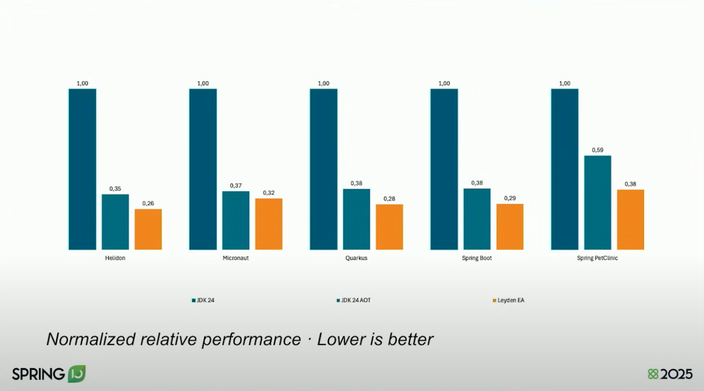

## Java 22 újdonságok

2024\. március

* JEP 423: Region Pinning for G1
* JEP 454: Foreign Function & Memory API
* JEP 456: Unnamed Variables & Patterns
* JEP 458: Launch Multi-File Source-Code Programs

## Java 22 Preview, Incubator

* JEP 447: Statements before super(...) (Preview)
* JEP 457: Class-File API (Preview)
* JEP 459: String Templates (Second Preview)
* JEP 460: Vector API (Seventh Incubator)
* JEP 461: Stream Gatherers (Preview)
* JEP 462: Structured Concurrency (Second Preview)
* JEP 463: Implicitly Declared Classes and Instance Main Methods (Second Preview)
* JEP 464: Scoped Values (Second Preview)

## Region Pinning for G1

* JNI esetén a C/C++ kódnak lehet pointere Java objektumra
* Ha ekkor mozgatja a GC az objektumokat, az problémát okoz
* Első megoldás, hogy ne fusson a GC
* JEP 423 - legyenek megjelölve az érintett régiók, és csak azokra ne fusson a GC

## Unnamed Variables & Patterns

* Nem a teljes objektumon dolgozunk, csak annak egy részén

Ciklusban:

```java
for (var _ : cars) {
    total++;
}
```

Értékadásban:

```java
var _ = update(command);
```

`catch` ágban:

```java
try {
    // ...
} catch (IllegalStateException _) {
    System.out.println("Got an illegal state exception");
} catch (RuntimeException _) {
    System.out.println("Got a runtime exception!");
}
```

Try-With Resources:

```java
try (var _ = new Transaction()) {
    updateCar(car);
}
```

```java
List.of("piros", "fehér", "zöld").forEach(_ -> System.out.println("color"));
```

## Launch Multi-File Source-Code Programs

## Data-Oriented Programming

### Bevezetés

* OOP gyakran komplex lesz
    * Többféle kapcsolat: association, aggregation, inheritance, use
    * Leszármazási hierarchia
    * Nehezen megérthető és módosítható
* Új programozási paradigma: Data-Oriented Programming
* Alapelvek:
    * Principle #1 - Separate code from data
    * Principle #2 - Represent data entities with generic data structures
    * Principle #3 - Data is immutable
* OOP és FP között helyezkedik el, mindkettővel kompatibilis, FP-hez közelebb áll

### Java/Brian Goetz

* Javaban saját értelmezés
* Részei
    * JEP 361: Switch Expressions (Standard) - Java 14
    * JEP 409: Sealed Classes - Java 17
    * JEP 440: Record Patterns - Java 21
    * JEP 441: Pattern Matching for switch - Java 21
    * JEP 456: Unnamed Variables & Patterns - Java 22
* Külön-külön is erősek, de egyben még erősebbek

```java
public abstract sealed class Shape
    permits Circle, Rectangle, Triangle {...}
```

```java
public Point getCenter(Shape shape) {
    return switch (shape) {
        case Circle(Point center, double _) -> new Point(center.x, center.y);
        case Rectangle(Point topLeft, Point bottomRight) ->
            new Point(
                (topLeft.x + bottomRight.x) / 2,
                (topLeft.y + bottomRight.y) / 2
            );
        case Triangle(Point p1, Point p2, Point p3) ->
            new Point(
                (p1.x + p2.x + p3.x) / 3,
                (p1.y + p2.y + p3.y) / 3
            );
    };
}
```

vs. template method design pattern

### Mikor használjuk

* Egyszerű data oriented service-ek esetén
* Adatfeldolgozás
* Batch folyamatok
* Data analysis
* Event processing
* Megfelelő rétegben, pl. DTO, integrációs
* Ne komplex üzleti logika esetén

## `ListFormat`

```java
var listFormat = ListFormat.getInstance(Locale.of("hu", "HU"), 
        ListFormat.Type.STANDARD, ListFormat.Style.FULL);
var colors = List.of("piros", "fehér", "zöld");
```

## Java 23 újdonságok

2024\. szeptember

- JEP 467: Markdown Documentation Comments
- JEP 471: Deprecate the Memory-Access Methods in sun.misc.Unsafe for Removal
- JEP 474: ZGC: Generational Mode by Default

## Java 23 Incubator, Preview

- JEP 455: Primitive Types in Patterns, instanceof, and switch (Preview)
- JEP 466: Class-File API (Second Preview) - Java 24-ben végleges
- JEP 469: Vector API (Eighth Incubator)
- JEP 473: Stream Gatherers (Second Preview) - Java 24-ben végleges
- JEP 476: Module Import Declarations (Preview)
- JEP 477: Implicitly Declared Classes and Instance Main Methods (Third Preview)
- JEP 480: Structured Concurrency (Third Preview)
- JEP 481: Scoped Values (Third Preview)
- JEP 482: Flexible Constructor Bodies (Second Preview)

## JEP 467: Markdown Documentation Comments

```java
/**
 * Returns a hash code value for the object. This method is
 * supported for the benefit of hash tables such as those provided by
 * {@link java.util.HashMap}.
 * <p>
 * The general contract of {@code hashCode} is:
 * <ul>
 * <li>Whenever it is invoked on the same object more than once during
 *     an execution of a Java application, the {@code hashCode} method
 *     must consistently return the same integer, provided no information
 *     used in {@code equals} comparisons on the object is modified.
 *     This integer need not remain consistent from one execution of an
 *     application to another execution of the same application.
 * <li>If two objects are equal according to the {@link
 *     #equals(Object) equals} method, then calling the {@code
 *     hashCode} method on each of the two objects must produce the
 *     same integer result.
 * <li>It is <em>not</em> required that if two objects are unequal
 *     according to the {@link #equals(Object) equals} method, then
 *     calling the {@code hashCode} method on each of the two objects
 *     must produce distinct integer results.  However, the programmer
 *     should be aware that producing distinct integer results for
 *     unequal objects may improve the performance of hash tables.
 * </ul>
 *
 * @implSpec
 * As far as is reasonably practical, the {@code hashCode} method defined
 * by class {@code Object} returns distinct integers for distinct objects.
 *
 * @return  a hash code value for this object.
 * @see     java.lang.Object#equals(java.lang.Object)
 * @see     java.lang.System#identityHashCode
 */
```

```java
/// Returns a hash code value for the object. This method is
/// supported for the benefit of hash tables such as those provided by
/// [java.util.HashMap].
///
/// The general contract of `hashCode` is:
///
///   - Whenever it is invoked on the same object more than once during
///     an execution of a Java application, the `hashCode` method
///     must consistently return the same integer, provided no information
///     used in `equals` comparisons on the object is modified.
///     This integer need not remain consistent from one execution of an
///     application to another execution of the same application.
///   - If two objects are equal according to the
///     [equals][#equals(Object)] method, then calling the
///     `hashCode` method on each of the two objects must produce the
///     same integer result.
///   - It is _not_ required that if two objects are unequal
///     according to the [equals][#equals(Object)] method, then
///     calling the `hashCode` method on each of the two objects
///     must produce distinct integer results.  However, the programmer
///     should be aware that producing distinct integer results for
///     unequal objects may improve the performance of hash tables.
///
/// @implSpec
/// As far as is reasonably practical, the `hashCode` method defined
/// by class `Object` returns distinct integers for distinct objects.
///
/// @return  a hash code value for this object.
/// @see     java.lang.Object#equals(java.lang.Object)
/// @see     java.lang.System#identityHashCode
```


- A `///` karakterekkel kell jelölni
- [CommonMark](https://commonmark.org/) változat
  - Lehet linkelni programkód elemeket, és
  - [GitHub Flavored Markdown](https://github.github.com/gfm/) táblázatokra

## JEP 471: Deprecate the Memory-Access Methods in sun.misc.Unsafe for Removal

Alternatívák:

- VarHandle API: biztonságos, típus-biztos, reflectionhöz hasonló API - Java 18-ban végleges
- Foreign Function & Memory API - Java 22-ben végleges

## JEP 474: ZGC: Generational Mode by Default

- JEP 439: Generational ZGC: Java 21-ben
- Apache Cassandra mérés
  - ZGC rosszabbul teljesített, mint a G1
  - Kiderült, hogy túl sok volt a frissen eldobandó objektum
  - Megoldás: ZGC is legyen generációs


https://inside.java/2023/11/28/gen-zgc-explainer/

Garbage collector megoldások:

- Nincs minden esetre jó GC
- A ZGC akár 4x annyi memóriát használ, mint a G1

Best practice:

- Mindig használjuk a legújabb JDK-t, már csak ettől is várható teljesítmény növekedés
- Netflix jó tapasztalat a Generational ZGC-vel

## Java 24 újdonságok

2025\. március

- JEP 472: Prepare to Restrict the Use of JNI
- JEP 475: Late Barrier Expansion for G1
- JEP 479: Remove the Windows 32-bit x86 Port
- JEP 483: Ahead-of-Time Class Loading & Linking (Leyden)
- JEP 484: Class-File API
- JEP 485: Stream Gatherers
- JEP 486: Permanently Disable the Security Manager
- JEP 490: ZGC: Remove the Non-Generational Mode
- JEP 491: Synchronize Virtual Threads without Pinning
- JEP 493: Linking Run-Time Images without JMODs
- JEP 496: Quantum-Resistant Module-Lattice-Based Key Encapsulation Mechanism
- JEP 497: Quantum-Resistant Module-Lattice-Based Digital Signature Algorithm
- JEP 498: Warn upon Use of Memory-Access Methods in sun.misc.Unsafe
- JEP 501: Deprecate the 32-bit x86 Port for Removal

## Java 24 Incubator, Preview, Experimental

- JEP 404: Generational Shenandoah (Experimental)
- JEP 450: Compact Object Headers (Experimental) (formerly known as Project Lilliput)
- JEP 478: Key Derivation Function API (Preview)
- JEP 487: Scoped Values (Fourth Preview)
- JEP 488: Primitive Types in Patterns, instanceof, and switch (Second Preview)
- JEP 489: Vector API (Ninth Incubator)
- JEP 492: Flexible Constructor Bodies (Third Preview)
- JEP 494: Module Import Declarations (Second Preview)
- JEP 495: Simple Source Files and Instance Main Methods (Fourth Preview)
- JEP 499: Structured Concurrency (Fourth Preview)

## JEP 472: Prepare to Restrict the Use of JNI

JNI használatakor a JVM warningot ír ki

## JEP 475: Late Barrier Expansion for G1

- JVM által beillesztett kódrészletek, melyek az objektum referencia alapján történő betöltésekor futnak le
- A JIT másik fázisában kerül beillesztésre, kevesebb overhead

## JEP 479: Remove the Windows 32-bit x86 Port

- Java 21-ben deprecated

## JEP 483: Ahead-of-Time Class Loading & Linking (Leyden)

- JVM indítási idő csökkentésére

  Startup time:

  - Alkalmazás készen áll az első lényegi feladat elvégzésére
  - Nem a `main()` első sora
  - Pl. első request kiszolgálása

  Warmup time:

  - Eléri a maximális teljesítményét

- Probléma a nyelv dinamikus volta miatt az osztálybetöltés
- Futó alkalmazás állapotát lementi, majd az gyorsabban tölthető be
- CDS természetes továbbfejlesztése
  - The AOT cache builds upon CDS by not only reading  
    and parsing class files ahead-of-time but also
    loading and linking them.
  - Különösen hatékony pl. lambda kifejezése  
    invokeMethod-dá átfordításakor
- Három fázis

  - Train

    Alkalmazás record módba kapcsolása, menti a betöltött osztályokat. Observations, megfigyelések.

    ```shell
    java -XX:AOTMode=record -XX:AOTConfiguration=app.aotconf Main
    ```

  - Assembly

    AOT cache archive előállítása

    ```shell
    java -XX:AOTMode=create -XX:AOTConfiguration=app.aotconf -XX:AOTCache=main.aot
    ```

  - Execution

    Futtatás

    ```shell
    java -XX:AOTCache=main.aot Main
    ```



Profitálnak a keretrendszerek, Helidon, Micronaut, Quarkus, Spring Boot, Jakarta EE implementációk

Hello world alkalmazásnál még látványosabb.

Train a production környezetben, vagy integrációs tesztekkel

További lehetőségek:

- JEP 515: Ahead-of-Time Method Profiling
- [JEP draft: Ahead-of-Time Code Compilation](https://openjdk.org/jeps/8335368)

## JEP 484: Class-File API

- Class file processing
- ASM, cglib, or ByteBuddy
- Új JDK kiadásakor utána kellett húzni
- Nagy nyomás hivatalos API kiadására
- Három lehetőség
  - Read bytecode
  - Generate bytecode
  - Transform bytecode

```java
var system = of("java.lang", "System");
var printStream = of("java.io", "PrintStream");

ClassFile.of().buildTo(
    Path.of("Echo.class"),
    of("Echo"),
    classBuilder -> classBuilder
        .withMethodBody(
            "main",
            MethodTypeDesc.of(CD_void, CD_String.arrayType()),
            ACC_PUBLIC | ACC_STATIC,
            codeBuilder -> codeBuilder
                .getstatic(system, "out", printStream)
                .aload(codeBuilder.parameterSlot(0))
                .iconst_0()
                .aaload()
                .invokevirtual(printStream, "println", MethodTypeDesc.of(CD_void, CD_String))
                .return_()));
```

## JEP 485: Stream Gatherers

- Kiterjesztési pont
- Saját intermediate operation
- Hasonló, mint a `collect()` terminate operation-ök között
- Előre megírt implementációk a `Gatherers` osztályban (hasonlóan, mint a `Collectors`)

https://www.baeldung.com/java-stream-gatherers

https://docs.oracle.com/en/java/javase/22/core/stream-gatherers.html#GUID-21AEE7E8-F7B3-496C-A61E-691EA947BBFB

- Kimenete is stream
- Képes one-to-one, one-to-many, many-to-one, or many-to-many leképzésre
- Képes információkat tárolni az előző elemekről: állapot, azaz state
- Short-circuit, képes leállítani a streamet
- Párhuzamos is lehet

Részei:

- Initializer: state kezdeti állapota
- Integrator: következő elem feldolgozása (használhatja a state-et, mehet tovább 0, 1, n elem)
- Combiner: párhuzamos szálakról eredmény összegyűjtése
- Finisher: végén még egy transzformáció

```java
var windows = IntStream.range(0, 10)
                .boxed()
                .gather(Gatherers.windowFixed(3))
                .toList(); // [[0, 1, 2], [3, 4, 5], [6, 7, 8], [9]]
```

```java
List<Employee> employees = Stream.of(1L, "John Doe", 2L, "Jane Doe", 3L, "Jack Doe")
    .<Employee>gather(Gatherer.ofSequential(
            Employee.EmployeeBuilder::new,
            Gatherer.Integrator.of(
                    (builder, element, downstream) -> {
                        if (element instanceof Long id) {
                            builder.id(id);
                        } else if (element instanceof String name) {
                            builder.name(name);
                            downstream.push(builder.build());
                        }
                        return true;
                    })
            ,
            Gatherer.defaultFinisher()

    )).toList();
```

```java
employees = Stream.of(1L, "John Doe", 2L, "Jane Doe", 3L, "Jack Doe")
                .gather(Gatherers.windowFixed(2))
                .map(window ->
                        new Employee((Long)window.get(0), (String)window.get(1))).toList();
```

## JEP 486: Permanently Disable the Security Manager

Senki sem használta, JDK karbantartását nagyban megnehezíti, hiszen átszövi

## JEP 490: ZGC: Remove the Non-Generational Mode

Generational mode beváltotta a hozzá fűzött reményeket

## JEP 491: Synchronize Virtual Threads without Pinning

- Virtual Threads továbbfejlesztése
- Pinning: virtuális szál nem tud leválni a platform szálról, így az adott platform szál nem tud váltogatni más virtuális szálak között
- Okozhatja:
  - Szinkronizált blokkok és metódusok használata
  - Néhány natív IO művelet
  - `ReentrantLock` használatakor
  - `ThreadLocal` használatakor
  - JNI használatakor
- Reaktív hívőknél gyakori érv, hogy miért kell a reaktív programozásnál maradni
- A Java 24 nem mindegyik problémát küszöböli ki
  - Néhány `synchronized` esetben megmaradhat a probléma, érdemesebb modern lockra átállni
  - IO esetén megmaradhat, helyette NIO használható
  - JNI esetén megmaradhat
    - Foreign Function and Memory API esetén is maradhat
    - Átírni Javaba
    - Külön microservice-be szervezni
    - Legrosszabb esetben dedikált pool
- Sajnos 3rd party library-kban lévő kód is okozhat pinninget
  - Előző megoldások egy része itt is alkalmazható
- Jobb diagnosztika

## JEP 493: Linking Run-Time Images without JMODs

Cloud környezetben számít a JDK mérete is. A jlink segítségével könnyített JDK-kat lehet létrehozni.

Az osztálykönyvtár a JDK-n belül két helyen is megtalálható:

- `jmods` könyvtárban JAR formátumú `.jmod` kiterjesztésű fájlok, direkt a `jlink`-nek
- `lib/modules` fájlban, binárisan, a JVM innen dolgozik

Ha a `jlink` az utóbbiból tudna dolgozni, nem lenne szükség az előbbire

## JEP 496: Quantum-Resistant Module-Lattice-Based Key Encapsulation Mechanism és JEP 497: Quantum-Resistant Module-Lattice-Based Digital Signature Algorithm

Module-Lattice algoritmus olyan, mely ellenáll a quantum számítógép támadásoknak

## JEP 498: Warn upon Use of Memory-Access Methods in sun.misc.Unsafe

Java 23-ban deprecated, itt WARN

## JEP 501: Deprecate the 32-bit x86 Port for Removal

32 bites x86 Linuxos port deprecated

Ezután csak az architecture-agnostic Zero port használható 32 bites rendszereken

## Java 25 újdonságok

* 2026. március
* LTS

- JEP 503: Remove the 32-bit x86 Port
- JEP 506: Scoped Values
- JEP 510: Key Derivation Function API
- JEP 511: Module Import Declarations
- JEP 512: Compact Source Files and Instance Main Methods
- JEP 513: Flexible Constructor Bodies
- JEP 514: Ahead-of-Time Command-Line Ergonomics
- JEP 515: Ahead-of-Time Method Profiling
- JEP 518: JFR Cooperative Sampling
- JEP 519: Compact Object Headers
- JEP 520: JFR Method Timing & Tracing
- JEP 521: Generational Shenandoah

## Java 25 újdonságok - preview, experimental

- JEP 470: PEM Encodings of Cryptographic Objects (Preview)
- JEP 502: Stable Values (Preview)
- JEP 505: Structured Concurrency (Fifth Preview)
- JEP 507: Primitive Types in Patterns, instanceof, and switch (Third Preview)
- JEP 508: Vector API (Tenth Incubator)
- JEP 509: JFR CPU-Time Profiling (Experimental)

## Remove the 32-bit x86 Port

Előző verzióban deprecated eltávolítása

## JEP 506: Scoped Values

* [ThreadLocal, Project Reactor Context és a Java 25 ScopedValue](https://www.jtechlog.hu/2026/03/15/context.html)

```java
@Slf4j
public class ScopedValueApplication {

    private final Random random = new Random();

    private final ScopedValue<String> requestId = ScopedValue.newInstance();

    static void main() {
        new ScopedValueApplication().run();
    }

    @SneakyThrows
    private void run() {
        try (ExecutorService executor = Executors.newFixedThreadPool(2)) {
            executor.invokeAll(IntStream.range(0, 3)
                    .mapToObj(i -> Executors.callable(this::processOrder))
                    .toList()
            );
        }
    }

    @SneakyThrows
    private void processOrder() {
        String id = UUID.randomUUID().toString();
        log.info("process: {}", id);
        Thread.sleep(random.nextInt(1000));
        ScopedValue.where(requestId, id).run(this::saveOrder);
    }

    private void saveOrder() {
        String id = requestId.get();        
        log.info("save: {}", id);
    }
}
```

## JEP 510: Key Derivation Function API

* PBKDF2 (Password-Based Key Derivation Function 2) - jelszavak hash-elésére
    * salt, iterációk száma – hányszor ismételjük a számítást (pl. 100 000+)

`KeyDerivationDemo.java`

```java
char[] password = "hunter2".toCharArray();
byte[] salt = "somesalt".getBytes();
PBEKeySpec spec = new PBEKeySpec(password, salt, 65536, 256);

SecretKeyFactory factory = SecretKeyFactory.getInstance("PBKDF2WithHmacSHA256");
SecretKey key = factory.generateSecret(spec);
```

Ennél már vannak modernebbek:

- bcrypt
- scrypt
- Argon2

### bcrypt

- Hash algoritmus jelszavak biztonságos tárolására, amelyet 1999-ben fejlesztettek ki a Blowfish titkosító algoritmus alapján
- salt, így ugyanaz a jelszó mindig más hash-t ad, ezzel megelőzve a rainbow table támadásokat
- Adaptív komplexitás: Bcrypt beállítható úgy, hogy lassítsa a hash-elést, ami megnehezíti a brute-force támadásokat
  - Emiatt CPU intenzív
- Technikai limit kb. 72 karakter

```
$2b$12$eIX0E6rGv2G7Q6PtDqWjxuZ5Yv7wY8s5vF3t8T3x6A0Wz6h0rQ9tC
```

Részei:

- Verzió
- Cost factor, azaz a hash számítás nehézségi szintje (2^12 iteráció)
- Salt
- Hash

DoS-olható, védekezési lehetőségek:

- Rate limit
- Account lockout

`org.springframework.security.crypto.bcrypt.BCryptPasswordEncoder`

### scrypt

- Memória-intenzív is
- Java `SCryptPasswordEncoder`

`org.springframework.security.crypto.scrypt.SCryptPasswordEncoder`

### Argon2

Argon2 a modern jelszó-hash algoritmusok legújabb sztenderdje

- Argon2d – főleg GPU-támadás ellen véd, CPU-intenzív, memóriát kevésbé használ.
- Argon2i – főleg side-channel támadások ellen véd, memóriát jobban használ.
- Argon2id – hibrid, egyszerre védi a brute-force és a side-channel támadások ellen. Ez a legajánlottabb a jelszó-hash-re.

Tulajdonságai

- Adaptív: beállítható a CPU idő, memóriahasználat és párhuzamos szálak száma.
- Memória-intenzív: memóriát is használ, így GPU/ASIC támadás kevésbé hatékony, nem csak CPU-ra épül.
- Salt: minden jelszóhoz egyedi salt.

```
$argon2id$v=19$m=65536,t=3,p=4$<salt>$<hash>
```

- m=65536 → memóriahasználat (KB)
- t=3 → iterációk száma
- p=4 → párhuzamos szálak száma

* `org.springframework.security.crypto.argon2.Argon2PasswordEncoder` -  Bouncy castle
* `org.springframework.security.crypto.password4j.Argon2Password4jPasswordEncoder` - Password4j

## JEP 511: Module Import Declarations

`ModuleImportDemo.java`

```java
import module java.base;

public class ModuleImportDemo {

    static void main() {
        LocalDate date = LocalDate.now();
        System.out.printf("Resolved Date: %s", date);
    }
}
```

## JEP 512: Compact Source Files and Instance Main Methods

`CompactSourceDemo.java`

```java
void main() {
    IO.println("Hello World");
}
```

## JEP 513: Flexible Constructor Bodies

```java
class Employee extends Person {

    String officeID;

    Employee(..., int age, String officeID) {
        if (age < 18  || age > 67)
            // Now fails fast!
            throw new IllegalArgumentException(...);
        this.officeID = officeID;   // Initialize before calling superclass constructor!
        super(..., age);
    }

}
```

## JEP 514 és JEP 515 - Ahead-of-Time...

* AOT osztálybetöltés könnyebb paraméterezhetősége, AOT cache létrehozása
* Profiling információk is kerüljenek az AOT cache-be
* Még nincs benne AOT compiler

## JEP 518: JFR Cooperative Sampling

* JFR
    * Beépített teljesítmény- és diagnosztikai eszköz (OpenJDK)
    * Nagyon alacsony overhead, akár prod-on is használható (~1%)
    * Event alapú, bináris fájlba ment

* Java Flight Recordernek képes megmondani az alkalmazások, hogy melyek a "safe sampling points"

## JEP 519: Compact Object Headers

* Experiments conducted as part of Project Lilliput show that many workloads have average object sizes of 256 to 512 bits (32 to 64 bytes).
* Header
    * Mark word: hash code, lock state, GC age, stb.
    * Class word: mutató a class metadata-ra
* Ebből a header 96 (compressed class pointer) - 128 bit (uncompressed)
* Megoldás:
    * Összevonja a két mezőt
    * A class pointert tovább tömöríti: compressed 32-ből ~22 bit, hiszen nem kell minden byte-ot címezni, objektumok igazítottan
    * Voltak szabad bitek, amiket eltávolított
    * Új lightweight locking mechanizmust használ 
* 64 bit lett
* Kevesebb memóriafoglalás (10 - 20% heap megtakarítás)
* Gyorsabb GC futás

## JEP 520: JFR Method Timing & Tracing

Minden metódushívást rögzít

## JEP 521: Generational Shenandoah

* Eddig nem volt generációs